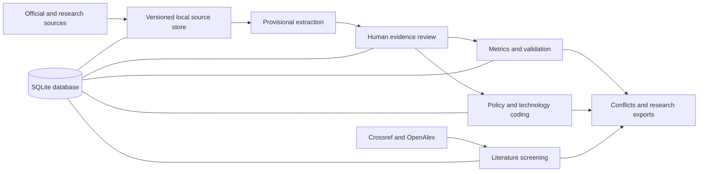

# Construction Safety Data Intelligence System (CSDIS)


A local-first research workspace for collecting construction-safety sources, preserving their provenance, reviewing evidence, and building reproducible policy, technology, and injury-metric records.

> **Project status:** Research prototype / first usable increment. The application and core workflows are implemented, but most seeded evidence and metrics still require human source review. This is a research workbench, not a safety-management or incident-reporting system.

## Contents

- [Overview](#overview)
- [What CSDIS does](#what-csdis-does)
- [Research integrity rules](#research-integrity-rules)
- [Technology stack](#technology-stack)
- [Quick start](#quick-start)
- [Using the application](#using-the-application)
- [Command-line source ingestion](#command-line-source-ingestion)
- [Project layout](#project-layout)
- [Local data, privacy, and backups](#local-data-privacy-and-backups)
- [Tests and quality checks](#tests-and-quality-checks)
- [Current research dataset](#current-research-dataset)
- [Limitations and roadmap](#limitations-and-roadmap)
- [Copyright, reuse, and project policies](#copyright-reuse-and-project-policies)

## Overview

CSDIS supports a research project examining how mandated construction-safety technologies align with reported injury hazards, with Hong Kong as the primary case and Singapore as a carefully bounded comparison. It is designed to help a researcher answer questions such as:

- What does an official source actually report, and where is the passage or table row?
- Which values, definitions, periods, cohorts, and denominators belong together?
- What does a policy require, for which projects, and from what date?
- What hazard does a documented technology module address, and what remains unknown about deployment or effectiveness?
- Which disagreements remain unresolved and need a human decision?

The system preserves original source files and raw extracted values, then keeps review, harmonisation, analysis, and export steps traceable to those sources.



## What CSDIS does

### Source collection and versioning

- Imports the supplied `CSDIS_Seed_Source_Registry.csv` and supports manual source registration.
- Stores uploaded or fetched source files as immutable versions, with content hashes and source metadata.
- Reuses an existing version when identical file content is registered again for the same source.
- Supports user-triggered retrieval of public HTTP(S) sources. Requests are bounded by size, time, redirects, and public-address checks; retrieval attempts are recorded. The fetcher does not log in, bypass access controls, or retrieve paywalled content.
- Provides an audited SHA-256 check for stored source versions.

### Document ingestion and evidence review

| Input | Current handling | Important caveat |
| --- | --- | --- |
| PDF | Page text via `pypdf`; candidate table rows via `pdfplumber`; source-specific parsers for selected DEVB and DI/464 tables | Extraction is provisional; table layouts can be misread. OCR is not implemented. |
| HTML | Provisional heading/paragraph evidence and candidate table rows via Beautiful Soup | Dynamic pages and content not present in the downloaded HTML may be missed. |
| CSV | Candidate rows with source locators | Parsed cell values are retained; interpretation is left to review. |
| XLSX | Candidate worksheet rows via `openpyxl` | Parsed values may differ from displayed spreadsheet formatting. |
| DOCX | Candidate table rows via `python-docx` | Only supported document tables are extracted; layout meaning still needs review. |

Evidence and candidate rows retain source-version identifiers and locators. Reviewers can inspect source text and, for PDF evidence, the original page. Review decisions and notes are kept separate from raw extracted content and recorded in the audit log. Human-verified table rows can be promoted into metric records by explicitly selecting label and value cells.

### Metrics, validation, and conflicts

- Records values with period, jurisdiction, classification dimension, units, numerator/denominator fields, denominator meaning, outcome definition, and comparability metadata where available.
- Keeps different taxonomies separate (for example, accident type, agent, unsafe action, unsafe condition, personal factor, injury nature, and body part).
- Checks percentage arithmetic and flags missing denominator meaning and other validation issues. It does not infer an unpublished denominator.
- Detects disagreements between comparable candidate records and preserves both values as an open conflict until a researcher adjudicates or reports it unresolved.
- Exports metric records to CSV with a JSON manifest containing metric identifiers, source versions, snapshot information, and the CSV checksum. Validation findings can be downloaded as JSON.

### Policy, technology, and hazard coverage

- Maintains evidence-linked registers for policy events, technology modules, and technology-to-hazard mappings.
- Keeps policy scope, mandate dates, documented function, automation mode, deployment status, and observed effectiveness as distinct concepts.
- Supports Direct, Indirect, No documented coverage, and Uncertain coverage classes, with a written rationale and coder/reviewer status.
- Checks that an automation label is compatible with the documented module mode; passive recording cannot be classified as AI detection without supporting evidence.
- Provides review transitions for proposed and independently coded mappings, adjudication, and locking. A second coder must differ from the original coder before independent coding is recorded.

A draft codebook and three-row draft pilot are included as [CSDIS_Coverage_Codebook_v1_DRAFT.md](CSDIS_Coverage_Codebook_v1_DRAFT.md) and [CSDIS_Coverage_Pilot_DRAFT.csv](CSDIS_Coverage_Pilot_DRAFT.csv). These files are not human-verified research findings. Each mapping stores two human-verified evidence links: hazard evidence (where the hazard is reported) and technology evidence (the module's documented function), matching the pilot CSV's `hazard_evidence_id` and `technology_evidence_id` columns. Mappings from the earlier single-evidence schema are migrated with that link kept as `legacy_evidence_id`; its role is not inferred, and the mapping cannot be adjudicated or locked until a researcher assigns both role-specific links.

### Literature discovery and screening

- Searches Crossref and OpenAlex for bibliographic metadata using user-triggered, paged queries.
- Logs each query, database, page, page size, result count, outcome, and timestamp.
- Flags possible DOI/title duplicates for human review; records are not automatically merged.
- Supports human screening status and exclusion reasons, plus local full-text attachments stored by content hash.
- Exports literature records as CSV, BibTeX, and RIS.

Search results are discovery aids. They do not replace source appraisal, full-text eligibility review, or citation checking.

### Audit history and portable backups

- Logs important user actions in an append-only audit register.
- Creates a portable ZIP backup containing a consistent SQLite snapshot, stored raw sources, local literature attachments, and a SHA-256 manifest.
- Includes a backup action in the application. Restore by stopping CSDIS and extracting the archive into the project directory so the original `data/` paths are recreated.

## Research integrity rules

CSDIS is built around the following safeguards:

1. **Source first:** Preserve original files and raw values. Harmonised or corrected fields do not silently replace source content.
2. **Traceability:** Link records to a stable source/version identifier and a page, section, row, or other locator when available.
3. **Human review:** Extracted passages, parsed table rows, and seeded values are provisional until a person checks them against the source.
4. **Explicit denominators:** Do not calculate a share or rate without a stated numerator, denominator, and denominator meaning.
5. **Bounded comparability:** Similar labels do not make two populations, outcomes, reporting thresholds, periods, or exposure bases comparable.
6. **No inferred deployment:** A mandate or specification does not demonstrate installation, compliance, operation, or effectiveness at every eligible site.
7. **No silent conflict resolution:** Conflicting official values remain visible side by side until a documented human decision is made.
8. **No default causal claims:** Aggregate trend data alone do not establish that a technology caused a change in injury rates.

## Technology stack

| Area | Technology |
| --- | --- |
| Runtime | Python 3.12+ |
| User interface | Streamlit 1.40+ |
| Local persistence | SQLite through Python's standard-library `sqlite3` module |
| Data contracts | Pydantic 2 |
| Tabular work | pandas |
| PDF text and tables | pypdf, pdfplumber |
| HTML parsing | Beautiful Soup 4 |
| Excel workbooks | openpyxl |
| Word documents | python-docx |
| HTTP requests | httpx |
| Tests | pytest |

`SQLAlchemy` is included in the dependency file for the planned persistence layer, but the current application issues database operations through `sqlite3` directly.

## Quick start

### Requirements

- Python 3.12 or newer
- The repository files, including `CSDIS_Seed_Source_Registry.csv`
- Network access only if you choose to fetch public sources or search Crossref/OpenAlex; stored local workflows work without those services

### Windows PowerShell

```powershell
py -3 -m venv .venv
.\.venv\Scripts\Activate.ps1
python -m pip install --upgrade pip
python -m pip install -r requirements.txt
streamlit run app.py
```

### macOS or Linux

```bash
python3 -m venv .venv
source .venv/bin/activate
python -m pip install --upgrade pip
python -m pip install -r requirements.txt
streamlit run app.py
```

Streamlit prints the local URL, normally <http://localhost:8501>. On first launch, CSDIS creates `data/local/csdis.sqlite3` and imports missing source records from the seed CSV. The app is designed for a single local researcher; it has no authentication or multi-user permissions.

To install the development dependencies and run the regression suite:

```bash
python -m pip install -r requirements-dev.txt
python -m pytest -q
```

## Using the application

The interface is organised into five top-level areas:

1. **Start here** - suggested workflow and key review cautions.
2. **Sources** - browse the source register, add a source, fetch a public source, or upload a file.
3. **Review data** - inspect evidence and table rows, create/review metrics, and handle conflicts.
4. **Research tools** - maintain policy and technology records, code coverage, and search/screen literature.
5. **Project tools** - inspect audit activity, check project status, and create a full backup.

### Recommended workflow

1. Browse the seeded register and confirm a source is appropriate for the research question.
2. Fetch or upload the source. Check its title, publisher, version, and stored file.
3. Review extracted evidence and table rows against the original page or document. Mark ambiguous or rejected material explicitly.
4. Create a metric only from a reviewed source row or a directly located evidence passage; preserve the published label and value.
5. Check the metric's denominator, outcome definition, population, period, and comparability status.
6. Review open conflicts without overwriting either observation.
7. Code policy or technology coverage only with explicit source support. Keep mandates separate from actual deployment.
8. Export the relevant ledger and manifest, then prepare a portable backup.

## Command-line source ingestion

To retrieve selected public sources from the seeded registry and run their available extractors:

```bash
python -m csdis.ingest_sources --source-id S001 --source-id S002 --source-id S003
```

Repeat `--source-id` to select more than one source. Retrieval is user-triggered and uses the same bounded public HTTP(S) behavior as the application. Source bytes and provisional extractions are stored locally; extracted records still need human review.

## Project layout

```text
.
|-- app.py                              # Streamlit interface
|-- csdis/
|   |-- backup.py                       # Consistent ZIP backup and manifest
|   |-- coverage.py                     # Technology-hazard mapping rules and review chain
|   |-- database.py                     # SQLite schema, connections, audit log
|   |-- ingest_sources.py               # CLI source retrieval
|   |-- ingestion.py                    # File extraction and source-specific parsers
|   |-- literature.py                   # Crossref/OpenAlex, screening, exports, files
|   |-- schemas.py                      # Pydantic record contracts
|   |-- seed.py                         # Seed registry import
|   |-- sources.py                      # Registration, safe fetch, versioning, checksums
|   `-- validation.py                   # Metric checks and conflict detection
|-- tests/                              # Offline regression tests and fixtures
|-- data/                               # Local database, originals, and attachments (ignored)
|-- CSDIS_Seed_Source_Registry.csv      # Seed source metadata
|-- CSDIS_Core_Data_Dictionary.csv      # Core field definitions
|-- LICENSE                            # MIT license for original software code
|-- IMPLEMENTATION_PLAN.md              # Detailed implementation status and roadmap
|-- requirements.txt                    # Runtime dependencies
`-- requirements-dev.txt                # Development/test dependencies
```

The repository also contains research documents and draft coding artifacts. Draft artifacts should be treated as working materials unless their review status says otherwise.

| Research artifact | Purpose |
| --- | --- |
| [Mandated_but_Mismatched_Research_Paper_Updated.docx](Mandated_but_Mismatched_Research_Paper_Updated.docx) | Current updated paper draft; findings remain subject to human evidence review. |
| [Human_Evidence_Review_Checklist.docx](Human_Evidence_Review_Checklist.docx) | Checklist for source, metric, policy, and coding review. |
| [CSDIS_Coverage_Codebook_v1_DRAFT.md](CSDIS_Coverage_Codebook_v1_DRAFT.md) | Provisional coverage coding rules. |
| [CSDIS_Coverage_Pilot_DRAFT.csv](CSDIS_Coverage_Pilot_DRAFT.csv) | Three provisional technology-to-hazard coding examples. |
| [CSDIS_Core_Data_Dictionary.csv](CSDIS_Core_Data_Dictionary.csv) | Core data-field definitions. |
| [IMPLEMENTATION_PLAN.md](IMPLEMENTATION_PLAN.md) | Detailed implementation history, outstanding tasks, and acceptance criteria. |

## Local data, privacy, and backups

Local working data is excluded from Git by `.gitignore`:

- `data/local/` - SQLite database
- `data/raw/` - immutable source files
- `data/literature/full_text/` - local full-text attachments
- `data/exports/` and `data/backups/` - generated outputs/backups

The app can make user-triggered network requests to retrieve public sources and query Crossref/OpenAlex. It does not automatically refresh source records or transmit the local SQLite database. Review the source and destination before fetching or searching. Keep backups in a separate, access-controlled location; the archive may contain copyrighted research files and locally collected data.

### Restore a backup

1. Stop the Streamlit process.
2. Keep a separate copy of the current `data/` directory if you may need it.
3. Extract the downloaded CSDIS backup ZIP into the project directory, preserving the archive's `data/` paths.
4. Restart the app and use the source-version checksum action to verify important originals.

The ZIP includes `backup_manifest.json` with archived paths, file sizes, and SHA-256 checksums.

## Tests and quality checks

Run the suite with:

```bash
python -m pytest -q
```

The offline regression suite covers:

- DEVB annual and monthly rate extraction, including period-aware conflicts and repeated-ingest idempotency
- Percentage arithmetic, denominator validation, and multiple-response warnings
- Source registration, immutable uploads, duplicate content, and checksum verification
- Mocked public HTTP success/failure, size limits, redirect behavior, and private-address redirect rejection
- CSV, XLSX, and DOCX cell preservation and malformed HTML table rows
- Taxonomy separation
- Coverage mappings: separate hazard/technology evidence, review-chain rules, and legacy single-evidence migration
- Literature full-text hashing, duplicate candidates, screening, and review guards

Tests use temporary databases, local fixtures, and mocked HTTP responses; they do not rely on live external websites. Fresh-install workflow verification remains an explicit gap; see the implementation plan.

## Current research dataset

The local research workspace is seeded with selected Hong Kong and Singapore sources. It currently includes:

- DEVB public-works accident data and a separate live historical accident-rate series
- Hong Kong 4S policy materials, Buildings Department requirements for mobile-plant and tower-crane alert systems, and public-works monitoring materials
- Singapore MOM sources on video surveillance requirements, WSH outcomes, and a separately tracked SafeSite Video Analytics pilot
- Ombudsman DI/464 construction fatal-accident counts and recommendations, retained as industry-wide context

**Review status matters:** the seeded evidence, technology modules, policy events, and metrics described in the implementation plan are provisional until source review. The 2025 rate discrepancy between 4.8 and 4.6 is intentionally left open. The values refer to distinct published entries/period contexts; do not choose one silently or present them as fully reconciled. DI/464 industry-wide fatality counts are not the same population or outcome as DEVB public-works reportable-accident rates. Singapore fatal-plus-major injury rates and public/private incident-report shares use different outcomes or bases and must not be combined with the Hong Kong series as equivalent rates.

For detailed source identifiers, review status, field definitions, open conflicts, and phase-by-phase completion notes, see [IMPLEMENTATION_PLAN.md](IMPLEMENTATION_PLAN.md) and [CSDIS_Core_Data_Dictionary.csv](CSDIS_Core_Data_Dictionary.csv).

## Limitations and roadmap

### Current limitations

- CSDIS is a local, single-user research prototype. Authentication, shared deployment, role-based access, and a hosted API/database are out of scope for the current increment.
- PDF table extraction is heuristic. Blank or scanned PDF pages are reported, but OCR is not implemented.
- HTML extraction cannot guarantee access to dynamic or script-rendered page content.
- Spreadsheet and Word extraction preserves parsed cells/tables, not all visual formatting or document semantics.
- Source-specific parsers cover selected DEVB and DI/464 tables; they are not general-purpose table understanding.
- Validation rules are useful checks, not a complete statistical or methodological review.
- Crossref/OpenAlex retrieval is page-based; deep cursor-based retrieval and open-access full-text retrieval are pending.
- Causal analysis, intervention-readiness checks, and integrated paper-ready analysis packages are not implemented.
- Most seeded evidence and metric rows have not been human-verified. The app does not substitute for checking original sources and independently reviewing coding decisions.

### Next development priorities

1. Complete the documented fresh-install and end-to-end acceptance checks.
2. Human-review DEVB, Buildings Department, Legislative Council, MOM, and Ombudsman evidence and metric records; retain unresolved conflicts until adjudicated.
3. Pilot the draft codebook with independent human coding and document disagreements before expanding the coverage matrix.
4. Add deeper literature pagination and reproducible multi-ledger exports with validation and provenance manifests.
5. Consider causal or interrupted-time-series analysis only after intervention timing, treated-project exposure, adoption/compliance, stable outcome definitions, and adequate pre/post observations are available.

See [IMPLEMENTATION_PLAN.md](IMPLEMENTATION_PLAN.md) for the full plan, implemented details, and acceptance criteria.

## Copyright, reuse, and project policies

### Current rights status

The repository includes an [MIT License](LICENSE) for the original CSDIS software code, with the copyright notice **Copyright (c) 2026 Rejuan Ahmed Ruhan**. This grant does not cover third-party sources, government publications, datasets, or research manuscripts and other research artifacts unless they carry a separate license or permission. Those materials retain their own rights and terms. Public visibility on GitHub is not a substitute for checking those source-specific rights.

Before distributing the software, the project owner should confirm that they have the right to license all included code under MIT, including any employment, university, funding, or contributor agreements that may apply. Copyright ownership can depend on authorship, employment, commissioning, and contract terms. The MIT grant applies only to original project code; it does not imply ownership of third-party sources.

### Third-party sources and datasets

Government reports, journal articles, standards, websites, photographs, and datasets retain their own rights and terms. A CSDIS source citation or attribution does not by itself grant republication rights. Before publishing or redistributing source text, tables, images, full-text files, or substantial extracts:

1. Check the exact source page, document, dataset, and applicable terms in force for that version.
2. Record the rights holder, licence or copyright notice, attribution text, access date, restrictions, and any permission evidence in a source-reuse register.
3. Distribute only the material and amount the applicable licence or permission allows. When rights are unclear, link to the original source and request permission before reproducing it.
4. Keep third-party source files out of a public repository unless redistribution is expressly allowed. The local CSDIS data directories are Git-ignored for this reason, but the ignore rules do not establish a legal right to store or redistribute a file.

Hong Kong Government website notices are not a single blanket licence: check the notice on each source site, and note that government notices commonly exclude third-party material. Singapore Government datasets on data.gov.sg are governed by the Singapore Open Data Licence; that dataset licence does not automatically cover all content on government websites or third-party rights within a dataset.

Official references (check the current notice for the actual source being reused):

- Hong Kong Intellectual Property Department: [What is copyright?](https://www.ipd.gov.hk/en/copyright/what-is-copyright/index.html) and [Copyright Notice](https://www.ipd.gov.hk/en/important-notices/index.html).
- Singapore Intellectual Property Office: [Ownership and Commercialisation](https://www.ipos.gov.sg/about-ip/copyright/ownership-and-commercialisation/).
- Singapore Government: [Singapore Open Data Licence](https://beta.data.gov.sg/open-data-licence) and [data.gov.sg privacy and terms](https://data.gov.sg/privacy-and-terms).

### Project policies to establish before public release

| Policy or file | Decision/action needed |
| --- | --- |
| `LICENSE` | MIT is selected for original software code. Confirm that project agreements allow the named owner to grant these rights. |
| `COPYRIGHT` / `NOTICE` | Keep the code copyright notice consistent with `LICENSE`; list third-party notices and material-specific licenses separately. A notice does not replace a license. |
| `THIRD_PARTY_NOTICES.md` or source-reuse register | Document source-specific license/terms, attribution, restrictions, permissions, and whether redistribution of the original file is allowed. |
| `CONTRIBUTING.md` | Set contribution review rules and require contributors to confirm they have the right to submit code under the project's MIT license; document any institution or employer approvals required. |
| Privacy and data-management policy | Define permitted data, access, retention, backup, and deletion practices. Do not add worker-identifiable or confidential records to the repository or public exports. Use aggregate or de-identified data where possible, and obtain institutional privacy/ethics review before collecting or processing personal data. |
| Research-integrity and publication policy | Require source verification, accurate attribution, transparent methods, reproducible coding decisions, and disclosure of unresolved conflicts and limitations. Follow the applicable university, funder, journal, and ethics-review requirements. |
| `SECURITY.md` | State how to report vulnerabilities and how secrets, local databases, source files, and backups are protected. Never commit credentials or private research data. |

Relevant official privacy guidance includes Hong Kong's [Personal Data (Privacy) Ordinance overview](https://www.pcpd.org.hk/english/data_privacy_law/ordinance_at_a_Glance/ordinance.html) and Singapore PDPC's [Advisory Guidelines on the PDPA for Selected Topics](https://www.pdpc.gov.sg/-/media/files/pdpc/pdf-files/advisory-guidelines/ag-on-selected-topics/advisory-guidelines-on-the-pdpa-for-selected-topics-4-oct-2021.pdf). CSDIS is currently intended for public source materials and aggregate research records; it is not a reviewed system for handling identifiable worker data.

The application queries Crossref and OpenAlex for literature metadata. Users and maintainers should also follow the services' current [Crossref REST API access and rate guidance](https://www.crossref.org/documentation/retrieve-metadata/rest-api/access-and-authentication/) and [OpenAlex Terms of Service](https://ra.openalex.org/OpenAlex_termsofservice.pdf).

### Contribution expectations

The software code is licensed under MIT. Until a formal contribution process is adopted, obtain the project owner's agreement before accepting contributions and require contributors to confirm they have the right to submit code under MIT. Contributions should preserve source provenance, review status, raw values, denominator meaning, and unresolved conflicts. Do not add third-party source files, credentials, personal data, or generated local databases to Git.

The links above are official information sources, not a substitute for reviewing the actual source-specific licence, institutional policies, or legal advice for the intended publication or distribution.
